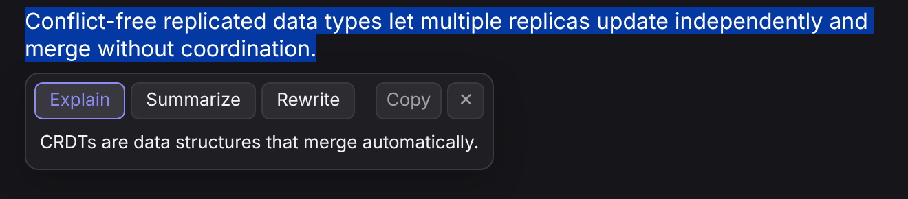

# ContextLens

[](https://github.com/ZiniuZheng/contextlens/actions/workflows/ci.yml)

ContextLens is a Chrome extension that brings AI assistance into any web page. Select text and a floating panel appears right next to it, letting you **explain**, **summarize**, or **rewrite** it, with the answer streaming in token by token. No copy-pasting into a separate chat window.



## Features

- **Works on any site**: select text, pick an action, read the answer in place
- **Streaming responses** from OpenAI or Anthropic models
- **Keyboard shortcut**: `Alt+Shift+E` explains the current selection
- **Light and dark mode** that follows the system theme
- **Copy** an answer with one click; `Esc` closes the panel
- **Settings page** for provider, API key and model

## Architecture

```
 web page                          extension
┌──────────────────────┐   port   ┌────────────────────────┐   HTTPS (SSE)   ┌──────────────┐
│ content script       │ ───────▶ │ background service     │ ──────────────▶ │ OpenAI /     │
│ panel in closed      │ ◀─────── │ worker: prompt, fetch, │ ◀────────────── │ Anthropic API│
│ Shadow DOM           │  deltas  │ stream parsing         │                 └──────────────┘
└──────────────────────┘          └────────────────────────┘
                                         ▲ chrome.storage.local (settings, API key)
```

- **Content script** (`src/content.ts`) builds the panel with native DOM APIs inside a **closed Shadow DOM**, so page CSS can't restyle it and page scripts can't read it. It has no imports because Chrome loads content scripts as classic scripts.
- **Service worker** (`src/background.ts`) owns every model call. Each request runs over its own `chrome.runtime` port; tokens are relayed as they arrive, and closing the panel disconnects the port, which aborts the HTTP request.
- **Shared logic** (`src/shared/`) is pure and unit-tested: prompt building, provider request construction, and an incremental **Server-Sent Events parser** that handles events split across network chunks.
- **Typed protocol** (`src/types/protocol.d.ts`) defines the messages exchanged between contexts.

## Security and privacy

- The API key is stored in `chrome.storage.local` (never synced) and is used only in the service worker, never in a web page's context.
- `host_permissions` are limited to the two provider APIs; the extension can't make requests to other sites.
- Model output is rendered with `textContent`, never `innerHTML`, so a response can't inject markup or scripts.
- Selections are capped at 6,000 characters before being sent.

## Getting started

```bash
npm install
npm run build
```

1. Open `chrome://extensions`, enable **Developer mode**, click **Load unpacked**, and select this folder.
2. Open the extension's **Options** page and add an OpenAI or Anthropic API key.
3. Select text on any page and click **Explain**, **Summarize** or **Rewrite**.

## Development

| Command | What it does |
| --- | --- |
| `npm run build` | Compile TypeScript to `dist/` |
| `npm run watch` | Rebuild on change |
| `npm test` | Run unit tests (Node test runner via tsx) |
| `npm run typecheck` | Type-check sources and tests |

GitHub Actions runs the type check, tests and build on every push and uploads the unpacked extension as a build artifact.

The project has no runtime dependencies. It is compiled with plain `tsc`, with no bundler, and ships minimal in-repo typings for the Chrome APIs it uses.

## Roadmap

- [ ] Follow-up questions in the same panel
- [ ] Use surrounding page content as extra context
- [ ] Custom actions defined in settings
